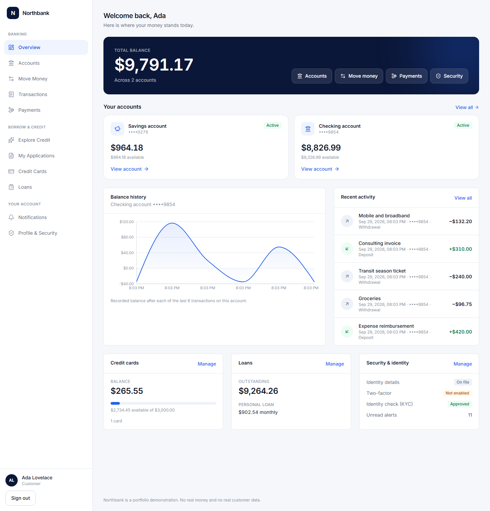
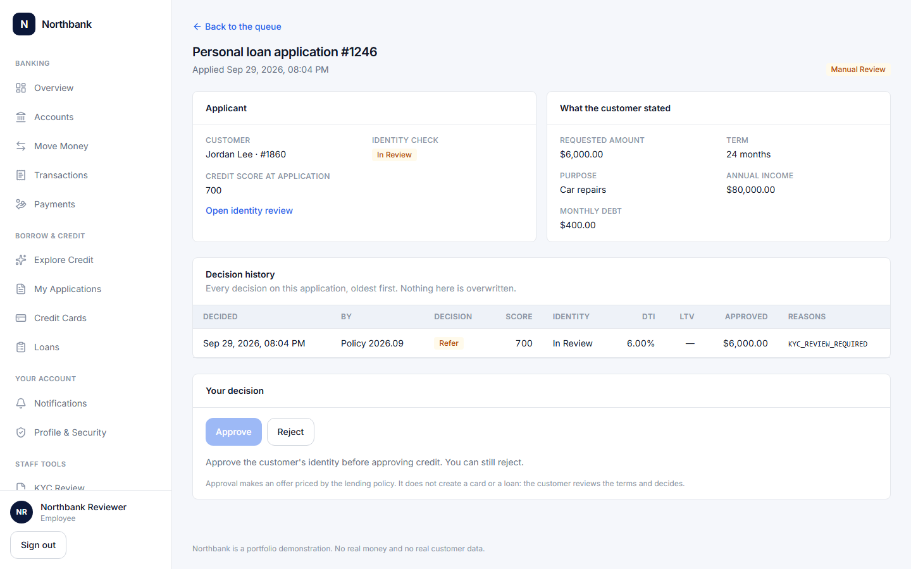
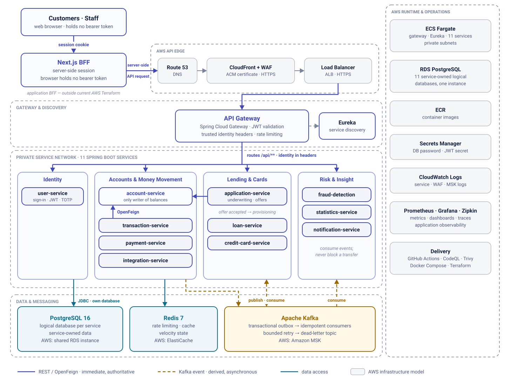

# Northbank — Event-Driven Banking Platform

Northbank is a full-stack banking portfolio project built with Java 21, Spring Boot, Apache Kafka, and Next.js. It brings customer onboarding, accounts, money movement, credit applications, loan and card servicing, and staff review into one console.

The platform runs 11 business services behind an API gateway, with Eureka for service discovery, PostgreSQL databases owned by each service, and Redis for rate limiting, caching, and fraud counters. Kafka carries events for product provisioning, notifications, statistics, and fraud detection.

This is a local demonstration using synthetic data. External wire, ACH, and SWIFT transfers are simulated records; they do not settle funds or debit balances.



## What you can explore

- **Customer onboarding:** registration, sign-in, optional TOTP two-factor authentication, profile management, and KYC review.
- **Everyday banking:** checking and savings accounts, deposits, withdrawals, transfers, beneficiaries, and scheduled or recurring payments.
- **Credit applications:** versioned underwriting decisions, staff review of referred applications, stored offers, customer acceptance, and event-driven product provisioning.
- **Product servicing:** loan disbursement, repayment schedules, instalments and payoff; card purchases, payments, interest, and statements.
- **Staff operations:** identity checks, application decisions, fraud alerts, and platform statistics, with ownership and role checks.
- **Operational visibility:** request correlation, distributed traces, Prometheus metrics, and provisioned Grafana dashboards.



See [Product Experience](docs/PRODUCT-EXPERIENCE.md) for more workflows and screenshots.

## Architecture

<picture>
  <source media="(prefers-color-scheme: dark)" srcset="docs/architecture/northbank-end-to-end-dark.svg">
  
</picture>

The browser communicates with the Next.js server. Server Components and Server Actions call the gateway; the JWT stays in an HttpOnly cookie. The gateway validates tokens, replaces client-supplied identity headers, applies rate limits, and routes requests through Eureka.

Only `account-service` changes account balances. Other services request balance changes through service calls. Transactional outboxes and consumer deduplication support event delivery; money movement endpoints use idempotency keys to make retries safe. Delivery guarantees and remaining consistency limits are documented in [Events](docs/EVENTS.md).

| Component | Port | Responsibility |
|---|---|---|
| `frontend` | 3000 | Next.js customer and staff console |
| `api-gateway` | 8080 | Public API, JWT validation, rate limiting |
| `eureka-server` | 8761 | Service discovery |
| `user-service` | 8081 | Identity, authentication, 2FA, KYC, credit score |
| `application-service` | 8082 | Applications, underwriting, offers, provisioning state |
| `account-service` | 8083 | Accounts, balances, overdrafts |
| `transaction-service` | 8084 | Deposits, withdrawals, transfers, reconciliation |
| `payment-service` | 8085 | Beneficiaries, scheduled and recurring payments |
| `statistics-service` | 8086 | Event-derived aggregates and cached read models |
| `notification-service` | 8087 | Customer alerts |
| `fraud-detection-service` | 8088 | Fraud rules, velocity checks, alerts, account freezes |
| `credit-card-service` | 8089 | Cards, purchases, payments, interest, statements |
| `loan-service` | 8090 | Loans, amortization, disbursement, repayments |
| `integration-service` | 8091 | Simulated external transfers and FX |

Business service ports are internal to the default Compose network. Use the gateway on port 8080 for API traffic. The [Architecture guide](docs/ARCHITECTURE.md) describes database ownership and service interactions.

## Quick start

### Prerequisites

- JDK 21 and Maven 3.8 or newer.
- Docker Desktop or Docker Engine with Docker Compose v2.
- Node.js 22 and npm for local frontend development or the demo seed script.
- Bash and curl for `scripts/seed-demo.sh` (for example, Git Bash or WSL on Windows).

The full stack includes 13 JVM processes plus the console and infrastructure. Each backend container has a 1 GiB memory limit; allow sufficient Docker resources, or use the infrastructure-only development option below.

### Configure the environment

From the repository root, copy the environment template:

```bash
cp .env.example .env
```

In PowerShell, use `Copy-Item .env.example .env`.

Replace `JWT_SECRET` in `.env` with a random secret of at least 256 bits. For example, generate one with:

```bash
openssl rand -base64 48
```

The gateway and user service must share the same secret; Compose passes the value to both. Keep `.env` local. The template also defines local PostgreSQL and demo reviewer credentials.

### Build and start

```bash
mvn clean package -DskipTests
docker compose up -d --build
docker compose ps
```

The backend images copy prebuilt JARs from each module's `target/` directory, so the Maven build must run before the Docker build. Allow several minutes for infrastructure health checks and service registration.

| Entry point | Address |
|---|---|
| Banking console | http://localhost:3000 |
| API gateway | http://localhost:8080 |
| Gateway readiness | http://localhost:8080/actuator/health/readiness |
| Eureka dashboard | http://localhost:8761 |
| Kafka UI | http://localhost:8095 |

PostgreSQL, Redis, and Kafka are available to local development tools on ports `5432`, `6379`, and `9094`, respectively.

### Try a customer and staff workflow

Register a customer in the console, or populate a demonstration customer from a Bash shell:

```bash
bash scripts/seed-demo.sh
```

The script needs Node.js and curl. It prints the generated customer credentials and creates accounts, transactions, a beneficiary, approved KYC documents, and serviced loan and card products through the public API. Each run creates a fresh customer. If you changed the reviewer credentials in `.env`, export the same `NORTHBANK_DEMO_STAFF_USERNAME` and `NORTHBANK_DEMO_STAFF_PASSWORD` values in the shell before seeding.

The default Compose stack creates this synthetic staff account:

| Username | Password |
|---|---|
| `northbank.reviewer` | `ReviewerDemo2026!` |

Use it to review identity documents and referred applications. Registration creates a customer profile; opening a deposit account is a separate action.

### Stop the stack

```bash
docker compose down
```

Named volumes retain data. Adding `-v` deletes the stack's persisted data, including its databases.

## Local development

To run infrastructure in Docker and services from an IDE:

```bash
docker compose -f docker-compose.infra.yml up -d
mvn install -DskipTests
```

Start `eureka-server`, then `api-gateway`, then the business services you need. Service configuration defaults to local infrastructure addresses. Set `JWT_SECRET` in the environment of both the gateway and user service; Compose's `.env` file is not automatically loaded by an IDE or Maven process.

To run the console against a running gateway, first stop the Docker frontend if it occupies port 3000, then:

```bash
cd frontend
npm ci
cp .env.example .env.local
npm run dev
```

The frontend's `API_GATEWAY_URL` defaults in the template to `http://localhost:8080`.

For local Swagger UI and direct service access:

```bash
docker compose -f docker-compose.yml -f docker-compose.dev-ports.yml up -d
```

This override exposes business service ports and enables their API documentation at `http://localhost:<service-port>/swagger-ui.html`. It bypasses the gateway boundary, so use it only for local debugging. API documentation is disabled in the normal stack.

See [Development](docs/DEVELOPMENT.md) for API routes, proxy certificate configuration, and additional setup details.

## Testing

Backend tests:

```bash
mvn test       # Unit and web-slice tests
mvn verify     # Includes integration tests; Docker must be running
```

Frontend checks, from `frontend/`:

```bash
npm ci
npm run lint
npm run typecheck
npm test
npm run build
npx playwright install chromium
npm run test:e2e
```

The default Playwright project uses a stubbed gateway and a production frontend build. Live Playwright scenarios and the root `e2e-tests.ps1` suite exercise a running stack; follow [Testing](docs/TESTING.md) for their environment and seed requirements.

## Observability

After starting the main stack, start the optional monitoring containers:

```bash
docker compose -f docker-compose.observability.yml up -d
```

| Tool | Address |
|---|---|
| Grafana | http://localhost:3001 |
| Prometheus | http://localhost:9090 |
| Zipkin | http://localhost:9411 |

Grafana allows anonymous dashboard viewing; local editing credentials are `admin` / `admin`. See [Observability](docs/OBSERVABILITY.md) for dashboards, metrics, tracing, and request correlation.

## Repository guide

| Path | Contents |
|---|---|
| `frontend/` | Next.js, React, TypeScript, Tailwind CSS, Vitest, and Playwright |
| `*-service/` | Spring Boot business services |
| `api-gateway/`, `eureka-server/` | Gateway and service registry |
| `common-events/` | Shared versioned event contracts |
| `common-kafka/` | Shared Kafka delivery support |
| `common-idempotency/` | Shared request idempotency support |
| `common-security/`, `common-observability/` | Caller identity, authorization, and telemetry support |
| `docker/`, `docker-compose*.yml` | Local runtime and database initialization |
| `observability/` | Prometheus configuration and Grafana dashboards |
| `infrastructure/aws/` | Terraform infrastructure model and architecture tests |
| `scripts/`, `e2e-tests.ps1` | Demo seeding and full-stack checks |
| `.github/workflows/` | CI, CodeQL, and security scans |

## Documentation

- [Architecture](docs/ARCHITECTURE.md): topology, data ownership, request flows, and design decisions.
- [Events](docs/EVENTS.md): contracts, topics, producers, consumers, retries, and delivery guarantees.
- [Security](docs/SECURITY.md): trust boundaries, ownership checks, authentication, and known limits.
- [Development](docs/DEVELOPMENT.md): local setup, API reference, and troubleshooting.
- [Testing](docs/TESTING.md): test suites and commands.
- [Observability](docs/OBSERVABILITY.md): metrics, dashboards, logs, and traces.
- [Product Experience](docs/PRODUCT-EXPERIENCE.md): illustrated customer and staff journeys.
- [Frontend](frontend/README.md): console structure and server-side API access.

## License

Copyright © 2026–present Kalabe Kebede. All rights reserved. This is proprietary portfolio software; see [LICENSE](LICENSE) for the terms.
